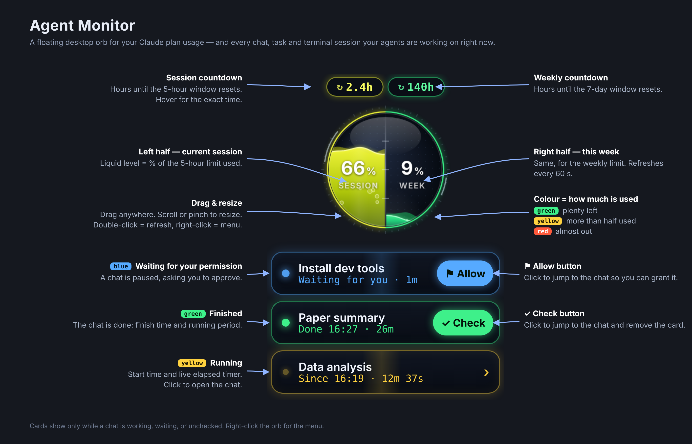
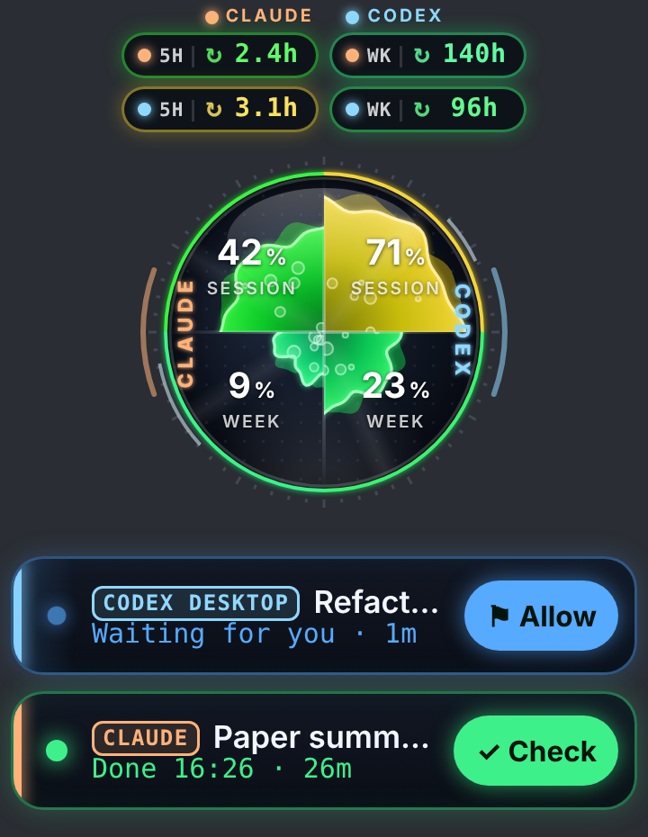

# Agent Monitor

A small floating desktop orb that shows your Claude plan usage at a glance — and, if you also use OpenAI Codex, your Codex usage next to it — plus a live card for every chat, task or terminal session your AI agents are working on right now.



**Top to bottom:** the two pills count down to the next usage reset (current 5-hour session on the left, weekly on the right). The sphere fills with liquid as you use your quota — left half is the session, right half is the week — and shifts from green to yellow to red as it fills. Underneath, a card appears for each chat or session that is **running** (yellow, with a live timer), **waiting for your permission** (blue, with an **Allow** button that jumps to it), or **finished** (green, with a **Check** button that opens it and dismisses the card).

The orb floats above every app and every desktop, including full-screen apps. Drag it anywhere, scroll or pinch to resize it, double-click to refresh.

## Features

- **Usage at a glance** — session and weekly utilization as animated liquid, with the percentage and a countdown to each reset. Same numbers as *Settings → Usage* on claude.ai, refreshed every 60 s.
- **Codex too (macOS)** — install Codex CLI and run `codex login` (or use *Sign in with Codex…* in the menu). The orb reads Codex limits through `codex app-server`, showing N/A for missing windows.
- **Three styles** — Classic orb, Witch's cauldron, or Claude + Codex. See [Styles](#styles) below.
- **Activity cards** — every chat that is running, waiting for permission, or finished-but-unchecked shows up under the orb. Checked every 6 s. Covers:
  - chats and Cowork tasks in the Claude desktop app or on the web,
  - cloud Claude Code sessions (claude.ai/code) — tagged `CODE`,
  - terminal Claude Code sessions on this machine — tagged `CLI` (macOS and Windows: via a Claude Code hook, installed automatically; Linux: by reading Claude Code's own session status files),
  - local Codex desktop chats — tagged `CODEX DESKTOP`, with running/completed cards and links to the chat (macOS).
  - terminal Codex CLI sessions on this machine — tagged `CODEX` (macOS: via a Codex hook, installed automatically when Codex is present).
- **One-click jump** — Allow / Check buttons open the chat so you can grant the permission or review the result.
- **Always on top, everywhere** — all Spaces, full-screen apps, every monitor.
- **Freely resizable** — scroll wheel or trackpad pinch on the orb, or pick a preset from the menu.
- **Menu bar icon** — refresh, hide/show, size, sign in again, launch at login, quit.
- **Remembers everything** — position, size, and unchecked cards survive restarts.

## Styles

Pick one from the menu: **Style → …**. Position, size and unchecked cards are kept when you switch.

<table>
<tr>
<td align="center" width="50%"><br><b>Witch's cauldron</b></td>
<td align="center" width="50%"><br><b>Claude + Codex</b></td>
</tr>
</table>

**Classic orb** (default) — the neon sphere shown at the top of this page. Left half is the current 5-hour session, right half is the week.

**Witch's cauldron** — a pastel, crayon-textured cauldron whose belly is the gauge (left: session, right: week), with a little witch hamster stirring it. Her mood follows your usage: content below 55 %, scheming between 55 and 85 %, panicking above 85 %, and above 88 % the potion boils over the rim. She naps while you are signed out and looks at you on hover. Countdown pills and cards get matching styling. Claude usage only.

**Claude + Codex** (macOS) — the sphere splits into four wedges: left half Claude, right half Codex; top row the 5-hour session, bottom row the week. Each wedge fills outward from the centre (area = % used) with the same green → yellow → red colouring. A fixed pair of *identity* colours — amber for Claude, ice-blue for Codex — marks the rim labels, the pills (now a 2×2 grid with `5H` / `WK` tags) and a stripe + tag on every card, so you can always tell which tool a number or a card belongs to. Codex usage comes from your signed-in Codex CLI account; local Codex desktop chats show up as `CODEX DESKTOP` cards and terminal Codex sessions as `CODEX` cards.

Both extra styles were contributed by [@liranmao](https://github.com/liranmao).

## Get it for your platform

| Platform | Status | Go to |
| --- | --- | --- |
| macOS | Stable, in daily use.<br>Monitors Chats, Cowork tasks, Claude Code (cloud + terminal) and Codex (usage + desktop + terminal). | [`macos/`](macos/) |
| Linux | Stable, in daily use.<br>Monitors Claude Code terminal sessions only. | [`linux/`](linux/) |
| Windows | In testing.<br>Monitors Chats, Cowork tasks, and Claude Code (cloud + terminal). | [`windows/`](windows/) |

All versions share the same orb (`orb.html`) and the same features; only the native shell differs.

## Project layout

```
AgentMonitor/
├── README.md          this overview
├── docs/              overview + style screenshots
├── macos/             native Swift app + installer
├── linux/             Electron app + X11 helper
└── windows/           Electron app + Claude Code hook
```

## How it works

Usage comes from the same endpoint the claude.ai settings page uses; chat and cloud-session activity from the same APIs the web app polls (`live_status` per conversation, `worker_status` per code session). These are unofficial and may change — if the orb shows **Offline**, that is the first thing to check. The app talks only to claude.ai and keeps your sign-in in its own private browser store.

Codex usage comes from the documented `account/rateLimits/read` app-server method, using Codex CLI’s existing sign-in and credential refresh. The orb reads the `codex` bucket from `rateLimitsByLimitId` (or the legacy `rateLimits` response), maps 300-minute and 10080-minute windows to session and week, and shows N/A for unavailable windows or failed reads. Each refresh has a 20-second timeout. Live zero usage is preserved; historical session logs are never substituted.

Terminal Claude Code and Codex sessions never touch the server, so they are tracked locally: the installer registers a [Claude Code hook](https://docs.claude.com/en/docs/claude-code/hooks) that writes one small JSON file per session on each event (prompt submitted, tool use, permission prompt, stop, session end), and the same script as a [Codex hook](https://developers.openai.com/codex/hooks) in `~/.codex/hooks.json` (Codex ≥ 0.124). The orb reads those files. Hooks apply to sessions started after installation.

## License

MIT. The Witch's cauldron style embeds two fonts under the SIL Open Font License 1.1: [Gaegu](https://fonts.google.com/specimen/Gaegu) (JIKJI SOFT) and [Sniglet](https://fonts.google.com/specimen/Sniglet) (Haley Fiege).
