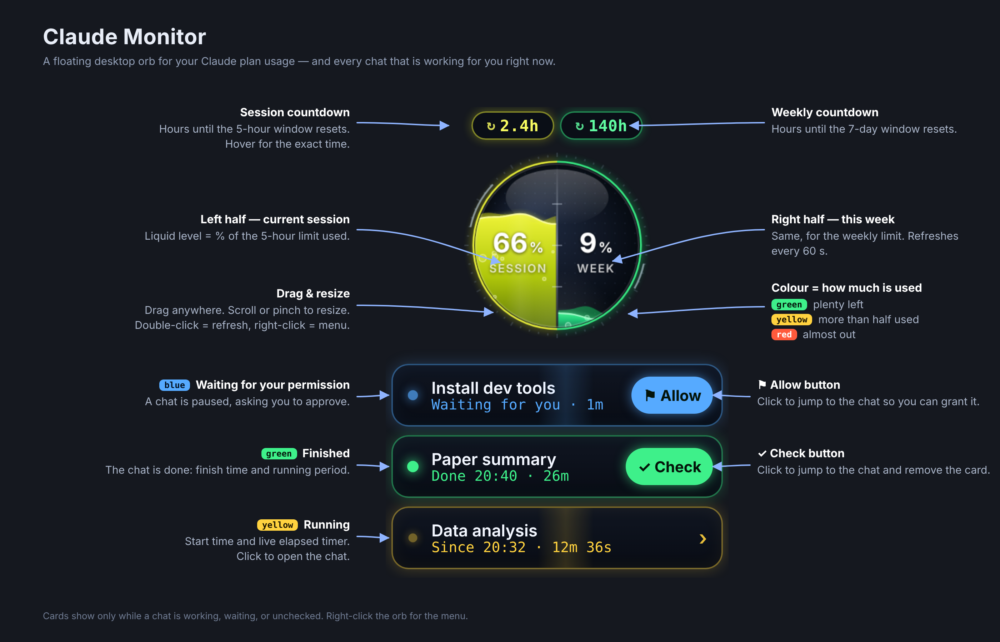
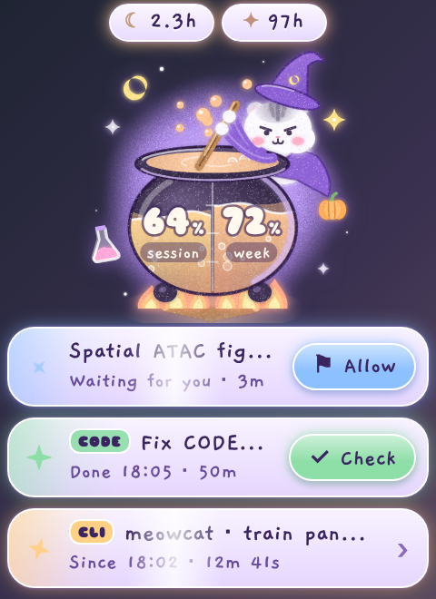

# Claude Monitor

A small floating orb for macOS that shows your Claude plan usage at a glance — and a live card for every chat that is working for you right now.



**Top to bottom:** the two pills count down to the next usage reset (current 5-hour session on the left, weekly on the right). The sphere fills with liquid as you use your quota — left half is the session, right half is the week — and shifts from green to yellow to red as it fills. Underneath, a card appears for each chat that is **running** (yellow, with a live timer), **waiting for your permission** (blue, with an **Allow** button that jumps to the chat), or **finished** (green, with a **Check** button that opens the chat and dismisses the card).

The orb floats above every app and every desktop, including full-screen apps. Drag it anywhere, scroll or pinch to resize it, double-click to refresh.

## Features

- **Usage at a glance** — session and weekly utilization as animated liquid, with the percentage and a countdown to each reset. Same numbers as *Settings → Usage* on claude.ai, refreshed every 60 s.
- **Activity cards** — every chat that is running, waiting for permission, or finished-but-unchecked shows up under the orb. Checked every 6 s. Covers:
  - chats and Cowork tasks in the Claude desktop app or on the web,
  - cloud Claude Code sessions (claude.ai/code) — tagged `CODE`,
  - terminal Claude Code sessions on this machine — tagged `CLI` (macOS and Windows: via a Claude Code hook, installed automatically; Linux: by reading Claude Code's own session status files).
- **One-click jump** — Allow / Check buttons open the chat so you can grant the permission or review the result.
- **Always on top, everywhere** — all Spaces, full-screen apps, every monitor.
- **Freely resizable** — scroll wheel or trackpad pinch on the orb, or pick a preset from the menu.
- **Menu bar icon** — refresh, hide/show, size, sign in again, launch at login, quit.
- **Remembers everything** — position, size, and unchecked cards survive restarts.
- **Two styles** — the classic neon orb, or **Witch's cauldron**: a pastel, crayon-textured cauldron whose belly is the gauge (left: session, right: week), with a little witch hamster stirring it. Her mood follows your usage (content → scheming → panicking, with the potion boiling over above 88%); she naps while signed out and looks at you on hover. Pick it from the menu: **Style → Witch's cauldron**.

## Get it for your platform

| Platform | Status | Go to |
| --- | --- | --- |
| macOS | Stable, in daily use.<br>Monitors Chats, Cowork tasks, and Claude Code (cloud + terminal). | [`macos/`](macos/) |
| Linux | Stable, in daily use.<br>Monitors Claude Code terminal sessions only. | [`linux/`](linux/) |
| Windows | In testing.<br>Monitors Chats, Cowork tasks, and Claude Code (cloud + terminal). | [`windows/`](windows/) |

All versions share the same orb (`orb.html`) and the same features; only the native shell differs.

<p align="center"></p>

## Project layout

```
ClaudeMonitor/
├── README.md          this overview
├── docs/overview.png
├── macos/             native Swift app + installer
├── linux/             Electron app + X11 helper
└── windows/           Electron app + Claude Code hook
```

## How it works

Usage comes from the same endpoint the claude.ai settings page uses; chat and cloud-session activity from the same APIs the web app polls (`live_status` per conversation, `worker_status` per code session). These are unofficial and may change — if the orb shows **Offline**, that is the first thing to check. The app talks only to claude.ai and keeps your sign-in in its own private browser store.

Terminal Claude Code sessions never touch the server, so they are tracked locally: the installer registers a [Claude Code hook](https://docs.claude.com/en/docs/claude-code/hooks) that writes one small JSON file per session on each event (prompt submitted, tool use, permission prompt, stop, session end). The orb reads those files. Hooks apply to sessions started after installation.

## License

MIT. The Witch's cauldron style embeds two fonts under the SIL Open Font License 1.1: [Gaegu](https://fonts.google.com/specimen/Gaegu) (JIKJI SOFT) and [Sniglet](https://fonts.google.com/specimen/Sniglet) (Haley Fiege).
